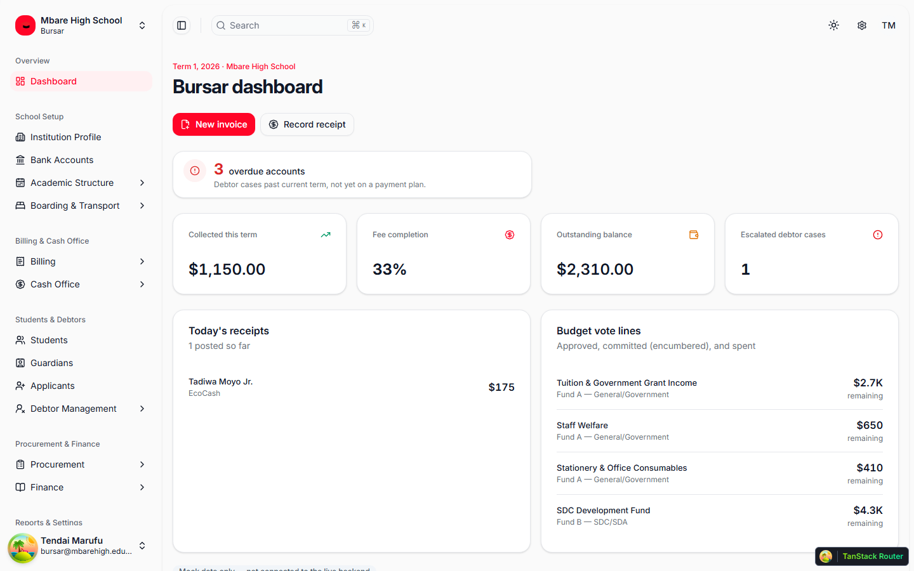
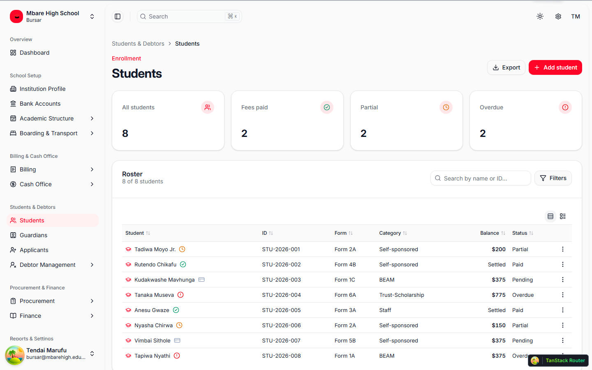
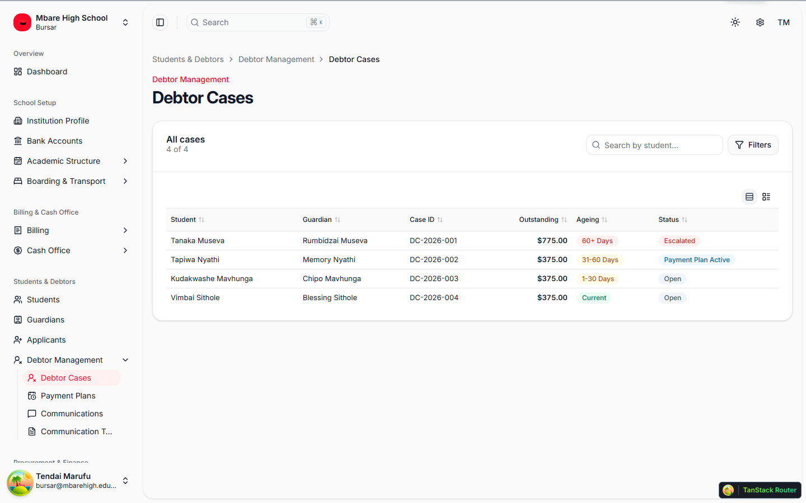
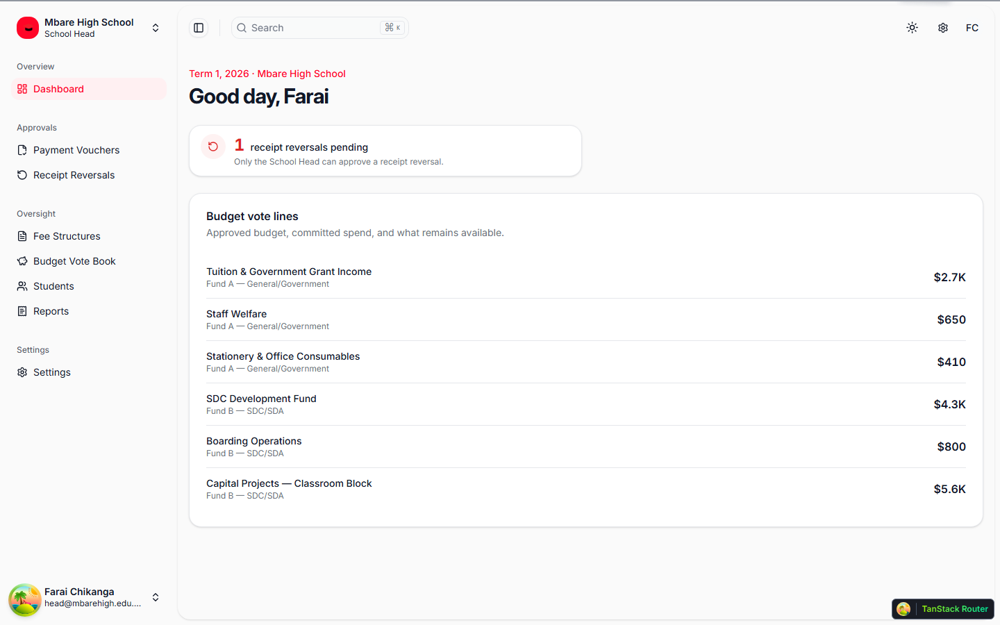
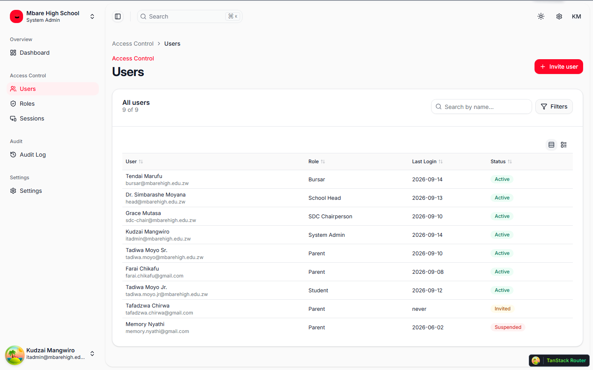

# Edupro Theme

The frontend UI theme for **Edupro SMS** (Edupro Cloud's school management system) — a compact, filter-first, keyboard-driven admin experience built with ShadcnUI and Vite. This is a mock-data frontend: every screen, form, and dataset is modelled around real school-finance workflows (Zimbabwean school fee administration specifically), ready to wire into a live backend.

It covers six role-scoped experiences from a single codebase — **Bursar**, **School Head**, **SDC** (School Development Committee), **System Admin**, and lightweight **Parent**/**Student** portals — sharing one set of primitives (data tables, filters, modals, forms) instead of one screen per role.

## Screenshots

**Bursar dashboard** — today's priorities (overdue accounts, pending approvals) surfaced above the standard KPI grid.


**Students** — the shared `DataList`/`FilterBar` pattern: sortable columns, composable filters, row density toggle.


**Debtor Cases** — ageing buckets and escalation status at a glance.


**School Head dashboard** — a second role sharing the same shell and primitives, scoped to its own approvals.


**System Admin — Users** — access control shared across every role in the platform.


## Features

- Six role-scoped shells (Bursar, School Head, SDC, System Admin, Parent, Student) sharing one design system
- Filter-first, search-first (⌘K cross-entity search with recent items)
- Compact enterprise density with a light/comfortable row-height toggle
- Real data tables (`DataList`): sorting, pagination, bulk actions, empty states
- Composable filters (`FilterBar`) with localStorage persistence and saved views
- Modal-driven mutations (max 2 CTAs), with unsaved-changes guards
- React Hook Form + Zod validation on every data-entry form
- Light/dark mode, WCAG AA (AAA on financial figures) contrast
- Responsive, accessible, RTL support

<details>
<summary>Customized Components (click to expand)</summary>

This project uses Shadcn UI components, but some have been slightly modified for better RTL (Right-to-Left) support and other improvements. These customized components differ from the original Shadcn UI versions.

If you want to update components using the Shadcn CLI (e.g., `npx shadcn@latest add <component>`), it's generally safe for non-customized components. For the listed customized ones, you may need to manually merge changes to preserve the project's modifications and avoid overwriting RTL support or other updates.

> If you don't require RTL support, you can safely update the 'RTL Updated Components' via the Shadcn CLI, as these changes are primarily for RTL compatibility. The 'Modified Components' may have other customizations to consider.

### Modified Components

- scroll-area
- sonner
- separator

### RTL Updated Components

- alert-dialog
- calendar
- command
- dialog
- dropdown-menu
- select
- table
- sheet
- sidebar
- switch

**Notes:**

- **Modified Components**: These have general updates, potentially including RTL adjustments.
- **RTL Updated Components**: These have specific changes for RTL language support (e.g., layout, positioning).
- For implementation details, check the source files in `src/components/ui/`.
- All other Shadcn UI components in the project are standard and can be safely updated via the CLI.

</details>

## Tech Stack

**UI:** [ShadcnUI](https://ui.shadcn.com) (TailwindCSS + RadixUI)

**Build Tool:** [Vite](https://vitejs.dev/)

**Routing:** [TanStack Router](https://tanstack.com/router/latest)

**Type Checking:** [TypeScript](https://www.typescriptlang.org/)

**Forms:** [React Hook Form](https://react-hook-form.com/) + [Zod](https://zod.dev/)

**Linting/Formatting:** [ESLint](https://eslint.org/) & [Prettier](https://prettier.io/)

**Icons:** [Lucide Icons](https://lucide.dev/icons/), [Tabler Icons](https://tabler.io/icons) (Brand icons only)

## Recent fixes (2026-09-23)

Paired with backend fixes of the same date (see the backend repo's README) after a
framework version bump broke several core Frappe endpoints this frontend relied on:

- **Login broken site-wide**: switched the post-login role fetch from
  `frappe.core.doctype.user.user.get_roles` (removed upstream) to a new backend
  endpoint, `edupro_school_fees.utils.get_my_roles` — every login was
  authenticating correctly but silently bouncing back to `/sign-in` because the
  role fetch that follows it was failing.
- **Statement / Account Overview double-counting**: `buildStatementSections()`
  and Payment Desk's Account Overview both summed `total_amount` across every
  invoice for a student, but a `Consolidated` invoice's total is already
  re-stated on the invoice that absorbed it — double/triple-counting the same
  debt. Both now exclude `Consolidated` invoices, matching
  `computeFeeStatus()`'s already-correct `outstanding_amount` pattern (also
  tightened to exclude `Consolidated` invoices from its own `totalInvoiced`).

## Run Locally

Clone the project

```bash
  git clone git@github.com:Edupro-Enterprises/edupro-theme.git
```

Go to the project directory

```bash
  cd edupro-theme
```

Install dependencies

```bash
  pnpm install
```

Start the server

```bash
  pnpm run dev
```
